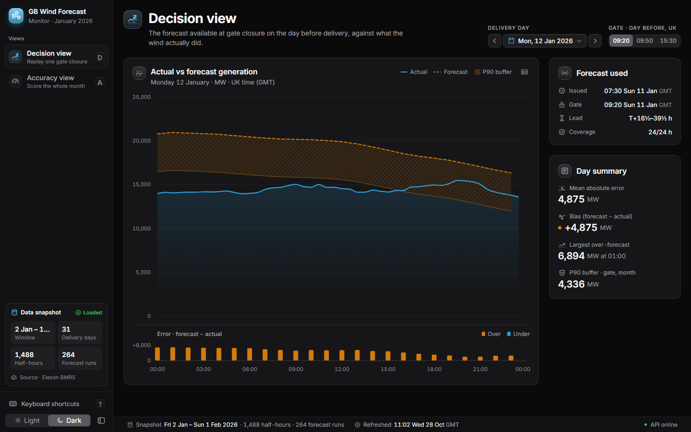
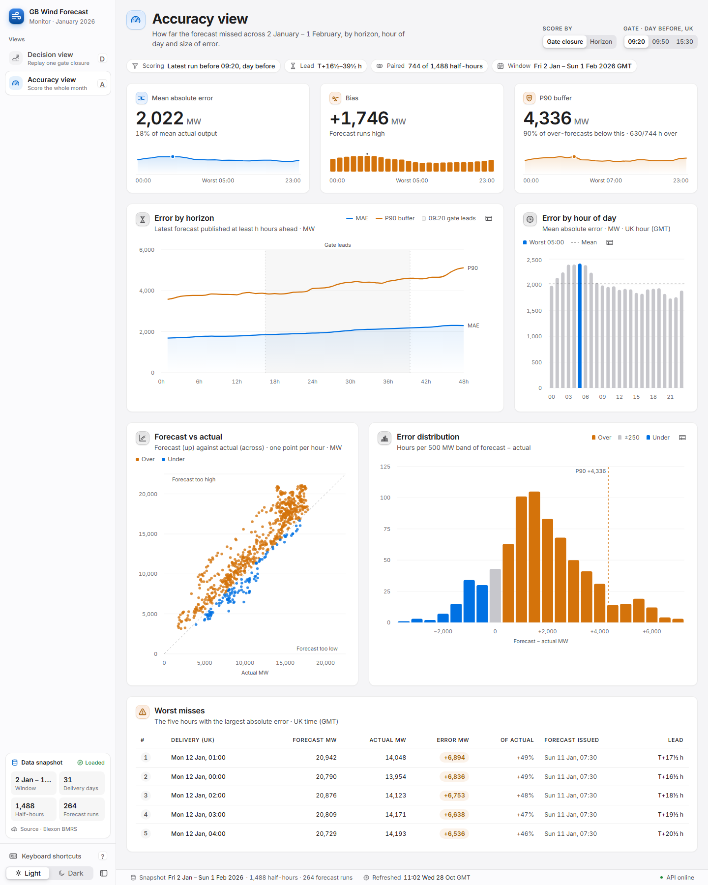

# GB Wind Forecast Monitor

_Working title._ Compares Elexon's published GB wind generation forecast (WINDFOR)
with actual wind outturn (FUELHH) for the day-ahead purchase decisions made in January
2026. Decisions are made the day before delivery, so the delivery days run from
2 January to 1 February.

- **Decision view** replays the forecast that was available at a gate time (09:20,
  09:50 or 15:30 UK time on the day before delivery) against what the wind actually did
  that day. It names the forecast run used, and its error strip shares a crosshair
  with the main chart.
- **Accuracy view** scores the forecast across those 31 delivery days: MAE, bias, the
  P90 over-forecast buffer, and error by horizon (0–48 h), by hour of day and by size,
  plus the five worst misses.

**Live app: https://sndnnsa.vercel.app.** The API docs are at
https://sndnnsa.vercel.app/docs (React on Vercel, with the FastAPI backend as a Python
function).





## Findings (decisions made in January 2026)

Scored on the 744 on-the-hour periods with both a forecast and an outturn. Mean
outturn over those hours is 11.3 GW.

| Gate (day before) | MAE | Bias | RMSE | P90 buffer | Hours over-forecast |
| --- | --- | --- | --- | --- | --- |
| 09:20 | 2,022 MW (17.9%) | +1,746 MW | 2,497 MW | 4,336 MW | 85% |
| 09:50 | 1,996 MW (17.7%) | +1,728 MW | 2,499 MW | 4,394 MW | 84% |
| 15:30 | 1,886 MW (16.7%) | +1,691 MW | 2,352 MW | 3,965 MW | 85% |

1. **The forecast runs high almost all the time.** At every gate it over-forecasts in
   about five hours out of six. At 09:20 it averages 13.0 GW against 11.3 GW of outturn,
   about 15% high. Only 4 of the 31 delivery days have a negative daily bias.
2. **The offset doesn't shrink with lead time, so it isn't weather uncertainty.** A
   forecast published just 1 hour ahead is still +1.5 GW high (MAE 1.69 GW). The
   constant bias accounts for about half of the squared error (49% at 09:20, 52% at
   15:30). Meanwhile the shape is right: forecast and outturn correlate at 0.93. This
   points to a level difference between the two datasets, which this analysis doesn't
   resolve (see Caveats).
3. **Error grows steadily with horizon:**

   | Published ahead | MAE | P90 buffer |
   | --- | --- | --- |
   | 1 h | 1.69 GW | 3.6 GW |
   | 24 h | 1.93 GW | 4.1 GW |
   | 48 h | 2.30 GW | 5.1 GW |

   At 48 h only 589 hours can be scored, because not every run reaches that far.
4. **A later gate helps a little; 09:50 doesn't.** Moving from 09:20 to 15:30 lowers
   MAE by 136 MW and the P90 buffer by 371 MW. At 09:50, MAE is 26 MW lower but the
   buffer is 58 MW higher.
5. **Early morning is worst.** At the 09:20 gate, MAE peaks at 03:00–05:00
   (2.39–2.41 GW) and is lowest at 21:00–22:00 (1.74–1.76 GW).
6. **The worst misses come from one run, on one night.** The five largest errors fall
   on 12 Jan 00:00–04:00, all from the run published 11 Jan 07:30: about 20.8 GW
   forecast against 14.1 GW actual, so +6.5 to +6.9 GW. By day, 28 Jan is the worst
   (11.1 GW forecast against 5.8 GW actual, MAE 5.3 GW), then 11 and 12 Jan (MAE
   4.9 GW).
7. **What it means for planning.** Relying on the 09:20 forecast, holding back about
   4.3 GW would have covered 90% of the over-forecast hours; at 15:30 the figure is
   4.0 GW. Most of that buffer is the steady offset. With the mean bias removed, the
   remaining error has a standard deviation of about 1.8 GW at 09:20.

## Method

- **Gate selection.** For each target hour, the latest run published *strictly before*
  the gate (Europe/London) on the day before the target's UK delivery day. Day
  arithmetic is done on London wall-clock time, so a clock change between D-1 and D
  can't move the gate.
- **Horizon selection.** The latest run published at least *h* hours before the target
  (`publishTime ≤ startTime − h`).
- **Scoring.** Error is forecast − actual, so positive means over-forecast. Forecasts
  are hourly and actuals half-hourly. Only on-the-hour periods are paired, so 744 of the
  1,488 half-hours are scored. Missing values stay missing: they are counted in
  coverage and excluded from every metric, never interpolated.
- **P90 buffer.** The 90th percentile of the over-forecasts only: the margin that would
  have covered 90% of the hours where the forecast came in too high.

The rules live in `backend/app/selection.py` and `backend/app/metrics.py`, with
hand-computed tests, including the gate boundary, DST and missing data.

## How it works

The API loads the parquet snapshot once and serves it compactly
(`GET /api/dataset`, about 50 KB gzipped). The browser computes every selection and
metric itself (`frontend/src/lib/engine.ts`), so after the first load no interaction
touches the network.

- Controls update on the same frame as the input.
- Charts follow in a React transition, keeping the previous view on screen meanwhile.
- The engine is checked against the backend's own answers, so the two can't drift:
  - `npm test` replays a fixture of backend outputs, including a dataset that spans
    the March clock change.
  - `make parity` compares every view the running API serves on the real data.

## Files and directories

```text
.
├── api/index.py                Vercel's Python entry point: the FastAPI app, reading the JSON snapshot
├── requirements.txt            Dependencies of that serverless function (no pyarrow, to stay under Vercel's limit)
├── backend/                    Python 3.11+: FastAPI, pandas
│   ├── app/
│   │   ├── ingest.py           Fetch FUELHH (WIND) and WINDFOR from Elexon: weekly chunks, retries, de-duplication
│   │   ├── selection.py        Latest forecast before a gate on D-1, or published at least h hours ahead
│   │   ├── metrics.py          MAE, RMSE, bias, nMAE, percentiles, P90 buffer, by hour, by horizon, worst misses
│   │   ├── dataset.py          Load the snapshot once (parquet, or JSON when serverless); version hash, fetch time
│   │   ├── views.py            Build and precompute every API response, and the compact snapshot
│   │   ├── schemas.py          Pydantic response models (camelCase JSON)
│   │   ├── api.py              Routes, validation, gzip, load on first use
│   │   ├── static.py           Serve the built frontend: immutable assets, SPA fallback
│   │   └── main.py             App factory: startup, background warm-up, ETag caching
│   ├── data/                   actuals.parquet, forecasts.parquet, snapshot.json (committed, so no network needed)
│   ├── scripts/                export_snapshot.py, export_engine_fixture.py, bench_api.py
│   ├── tests/                  pytest: selection, metrics, ingest, dataset, API
│   └── pyproject.toml          Dependencies, plus ruff, mypy and pytest settings
├── frontend/                   React 19, Vite, TypeScript, Tailwind CSS, shadcn/ui, Recharts, TanStack Query
│   ├── src/
│   │   ├── App.tsx             Routes, view state, keyboard shortcuts, idle warm-up
│   │   ├── pages/              decision-view.tsx and accuracy-view.tsx, each its own chunk
│   │   ├── components/         Chart and KPI cards, controls, sidebar, page shell,
│   │   │                       glyphs.tsx (the app's icon set), ui/ (shadcn/ui)
│   │   ├── lib/                engine.ts (selections and metrics in the browser), queries, view-state,
│   │   │                       format, motion, hover, health, shortcuts
│   │   └── styles/             tokens.css (design tokens: themes and chart palette), shadcn.css
│   ├── tests/                  engine.test.ts (backend parity on fixtures), parity.live.ts, e2e/ (Playwright)
│   ├── scripts/                Initial-JS budget check; snapshot copy for the static build
│   └── *.config.ts             Vite, Vitest, Playwright
├── docs/                       DECISIONS.md (design decisions, as reviewer questions), screenshots/
├── .github/workflows/ci.yml    CI: ruff, mypy, pytest; frontend checks; Playwright; Lighthouse; Docker
├── Dockerfile                  One image: builds the UI, serves the UI and the API
├── docker-compose.yml          docker compose up --build runs the whole app
├── vercel.json                 Vercel: React build plus the Python function, deep-link rewrites
├── render.yaml                 Render blueprint for the Docker image
├── Makefile                    install, dev, test, e2e, serve, up, refresh-data, bench, size, lighthouse
├── lighthouserc.json           Lighthouse CI thresholds
└── PERFORMANCE.md              Measurements: bundle, Lighthouse, API latency, interactions
```

## Getting started

**Quickest: Docker.** Run `docker compose up --build`, then open http://localhost:8000
(API docs at /docs).

**For development**, you need Python 3.11 or newer, Node.js 20.19+ (or 22.12+), and GNU
Make.

```sh
make install        # backend/.venv + frontend node_modules
make dev            # API on http://localhost:8000 (docs at /docs), UI on http://localhost:5173
make test           # ruff, mypy, pytest, then frontend type-check, lint and engine tests
make e2e            # Playwright, in Chrome, against the production build
make refresh-data   # optional: re-fetch the snapshot from Elexon into backend/data/
```

The API is ready about a second after it starts. It builds the snapshot first and
prepares every other response in the background. If port 5173 is taken, Vite picks the
next free one and prints it.

To analyse another window, change the dates in `backend/app/ingest.py` and run
`make refresh-data`. The UI takes its date range from the data.

Production: `make serve` builds the frontend, then serves it and the API from one
origin on http://localhost:8000.

### Using it

Each view's selection is in the URL, and Back/Forward step through pages:

```text
/decision?day=2026-01-12&gate=09:50
/accuracy?mode=gate&gate=15:30
/accuracy?mode=horizon&h=12
```

| Key | Action |
| --- | --- |
| `←` / `→` | Decision: previous/next day. Accuracy: horizon −1/+1 h, or previous/next gate in gate mode |
| `Shift` + `←` / `→` | A week, or 6 hours |
| `Home` / `End` | First/last day, or horizon 0/48 h |
| `1` `2` `3` | Gate 09:20 / 09:50 / 15:30 |
| `G` / `H` | Accuracy: score by gate / by horizon |
| `D` / `A` | Decision / Accuracy view |
| `?` | Show all shortcuts |

The day buttons repeat while held. Hovering the hour-of-day chart highlights the same
hour in the three KPI sparklines, and the reverse also works.

## Checks

| Command | What it checks |
| --- | --- |
| `make test` | Backend: ruff, mypy, 111 pytest tests. Frontend: type-check, lint, 30 engine tests |
| `make e2e` | 8 Playwright tests: one data request, shortcuts, URL and history, crosshairs, no console errors |
| `make parity` | The engine against every API view on the real data (needs `make serve`) |
| `make engine-fixture` | Regenerates the engine fixture after a rule change |
| `make bench` / `make size` / `make lighthouse` | API p50/p95, the 180 KB initial-JS budget, Lighthouse CI |

CI (`.github/workflows/ci.yml`) runs five jobs:
- backend: ruff, mypy, pytest;
- frontend: type-check, lint, tests, build, size budget;
- Playwright end-to-end tests;
- Lighthouse;
- a Docker build with a smoke test of the running image.

Measurements are in [PERFORMANCE.md](PERFORMANCE.md). The reasoning behind the
choices, written as the questions a reviewer would ask, is in
[docs/DECISIONS.md](docs/DECISIONS.md).

## Deploy

**Vercel: the full app, React plus the Python API.** Import the repository in Vercel;
`vercel.json` sets everything:
- It builds the frontend.
- `api/index.py` runs FastAPI as a Python function.
- It routes `/api/*`, `/docs` and `/openapi.json` to that function, and everything
  else to the app.

The function reads `backend/data/snapshot.json`, not the parquet, so it doesn't need
pyarrow, which keeps it within Vercel's size limit (about 165 MB installed). A test
checks the two sources give identical API responses, and another fails if
`snapshot.json` drifts from the parquet. `make refresh-data` regenerates both.

There's also a static build with no API (`npm run build:static`). It reads the
snapshot from a file instead, for hosts without Python.

**Docker: one image, UI and API.**

```sh
docker compose up --build                       # or:
docker build -t gb-wind-forecast . && docker run --rm -p 8000:8000 gb-wind-forecast
```

The image honours `$PORT`, runs as a non-root user and has a health check. It uses
about 140 MB of memory. `render.yaml` deploys it as a Render web service
(New → Blueprint).

## Caveats

- **Bias.** Across the window the forecast sits well above outturn: about +1.7 GW at
  the 09:20 gate. This analysis doesn't establish why. Candidates are:
  - curtailment, where FUELHH records metered output after constraint actions and the
    forecast doesn't;
  - differences in which wind units each dataset covers.

  The app reports the bias and doesn't attribute it.
- **Pairing.** Hourly forecasts are compared only with the on-the-hour half-hour of
  outturn.
- **Data.** Elexon BMRS Insights Solution API, datasets FUELHH (fuel type `WIND`) and
  WINDFOR. Times are shown in UK local time; the whole window is GMT.

## API

```text
GET /api/health
GET /api/dataset                                      (the snapshot the UI computes from)
GET /api/meta
GET /api/actuals?start&end
GET /api/forecast/gate?day=YYYY-MM-DD&gate=09:20|09:50|15:30
GET /api/forecast/horizon?h=0..48&start&end
GET /api/metrics?mode=gate|horizon&gate&h
GET /api/view/decision?day=YYYY-MM-DD&gate=09:20      (one Decision view, precomputed)
GET /api/view/accuracy?mode=gate|horizon&gate         (one Accuracy view, precomputed)
```

Responses are gzipped and carry a weak ETag for the data snapshot, with
`Cache-Control: no-cache`. Browsers revalidate on each load: they get a 304 while the
data is unchanged, and the new snapshot as soon as it changes.
